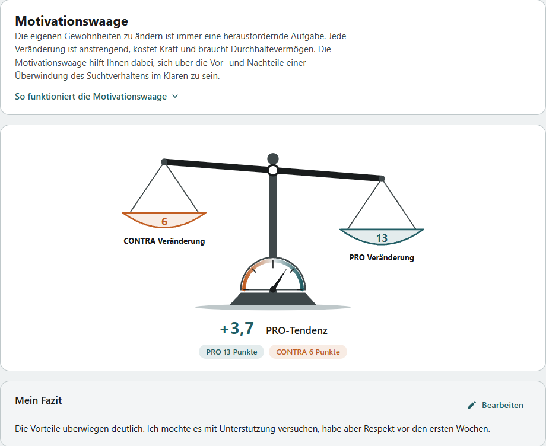
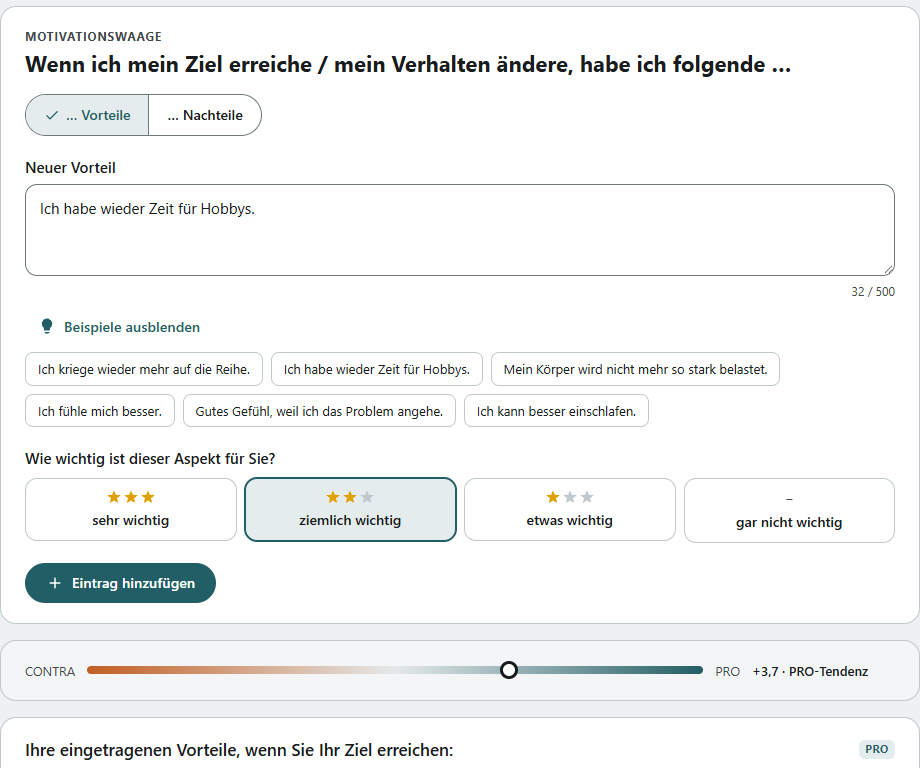
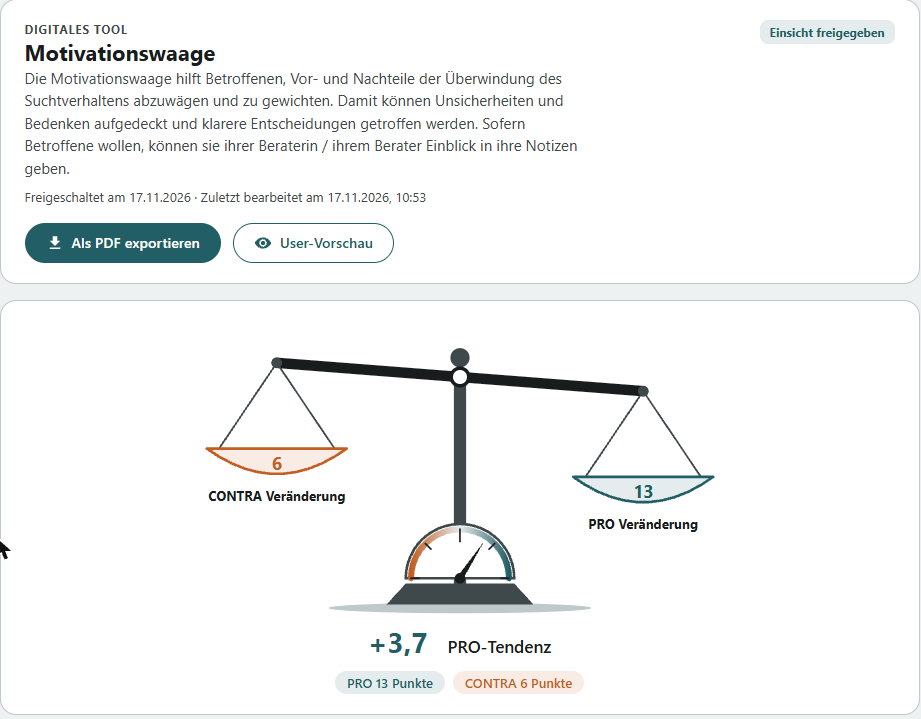

# Motivationswaage

Ratsuchende wägen die Vor- und Nachteile einer Veränderung ihres Suchtverhaltens ab und gewichten sie. Die Waage zeigt, wohin ihre innere Haltung gerade neigt. So werden Unsicherheiten und Bedenken sichtbar, über die man in der Beratung sprechen kann.

**So funktioniert es**

- Die Beraterin oder der Berater schaltet die Motivationswaage im Fall frei. Die ratsuchende Person wird benachrichtigt und findet sie in ihrer Navigation.
- Argumente in vier Listen: Vor- und Nachteile, wenn sich etwas ändert, und wenn alles bleibt, wie es ist. Jedes Argument wird von „gar nicht wichtig“ bis „sehr wichtig“ (0 bis 3 Punkte) bewertet. Beispieltexte helfen beim Einstieg.
- Die Waage rechnet die gewichteten PRO- und CONTRA-Punkte auf eine Skala von −10 bis +10 um. Sie bewertet also das Verhältnis, nicht die Zahl der Argumente. Dazu kommt ein persönliches Fazit.

**Für die Beratung**

- Inhalte sieht die Beratung nur, wenn die ratsuchende Person sie teilt. Freischaltung und Einsicht sind getrennt, und das Teilen lässt sich jederzeit zurücknehmen.
- Geteilte Inhalte erscheinen im Fall schreibgeschützt: Waage, Fazit und alle Argumente mit Bewertung. Sie lassen sich als PDF exportieren.
- Die Beratung wird benachrichtigt, wenn eine ratsuchende Person teilt oder Einträge ändert, höchstens einmal in 30 Minuten. Benachrichtigungen enthalten keine Inhalte.
- In der „User-Vorschau“ probieren Beratende die Übung mit Testdaten aus, ohne dass etwas gespeichert wird.

**Einstellungen**

- Eigener Einleitungstext je Träger oder Beratungsstelle
- Beschriftung der Waage: „CONTRA / PRO Veränderung“, „keine Veränderung / Ich möchte etwas ändern!“ oder „gut so, wie es ist / es muss sich was ändern!“
- Teilen mit der Beratung erlauben oder abschalten

**Statistik:** freigeschaltete, begonnene und geteilte Waagen.
